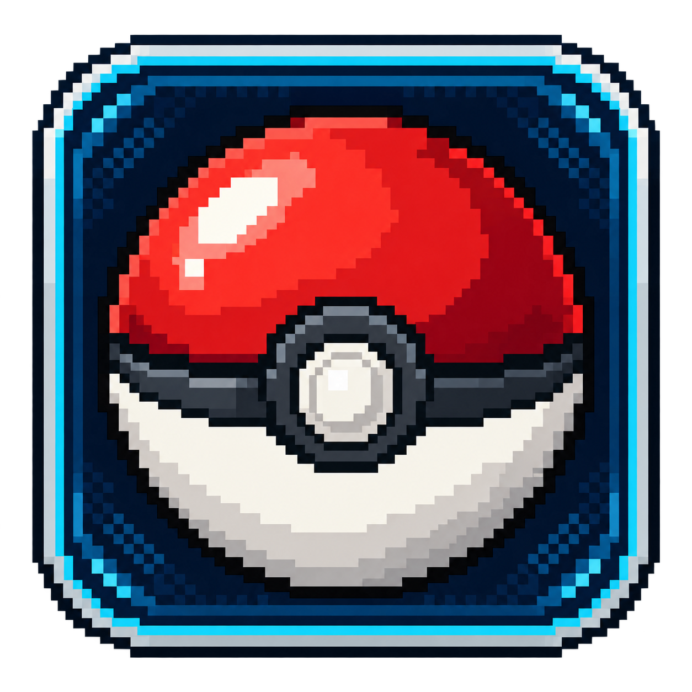
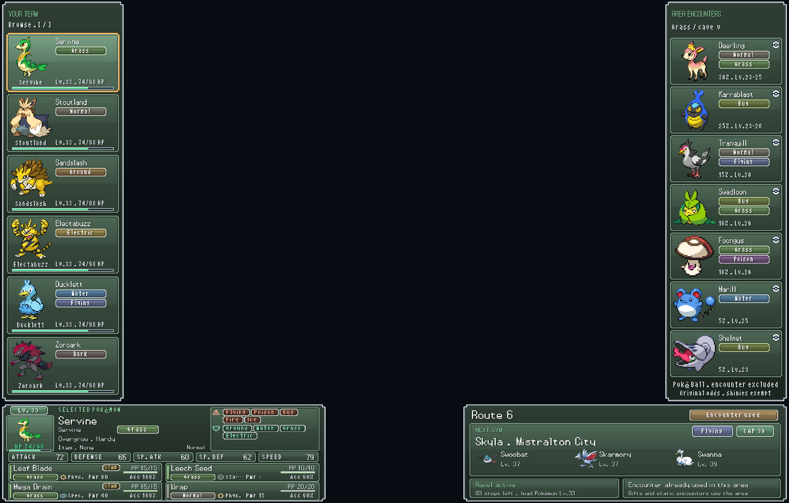

<p align="center"></p>

# Nuzlocke Companion

A native **macOS overlay for melonDS** that keeps your Nuzlocke team, encounters and level caps beside the game. The interface and documentation are in **English**.

**Current compatibility: Pokémon White 2, Italian edition (`IRDI`), with melonDS 1.1.** English-language game editions, Black 2, randomizers and other emulators are not supported by this release. Translating the interface does not make the game's memory layout interchangeable.



*The center of this preview is reserved for the emulator screens. The example uses synthetic Pokémon data; no player's save or run history is included.*

## Features

- Four panels fitted to the black areas around a large top screen and a small, centered bottom screen.
- Team sprites, nicknames, types, HP and configurable previous/next Pokémon shortcuts.
- Detailed stats, ability, nature, held item, move type/category, power, accuracy and current PP. Click for IVs, EVs and move descriptions.
- Automatic battle detection and following of your active Pokémon. Opponent moves stay hidden until the monitor observes their use.
- Live area detection, encounter methods, seasonal odds, level ranges and duplicate-family exclusions.
- First-encounter ledger, permanent death tracking, shiny exception and manual corrections. Gifts and static encounters consume the area when obtained.
- Gym and League level caps, the next boss's team, and remaining Repel steps.
- Pokémon-style frames, locally extracted bitmap lettering and colors matched to each area.

The app reads memory through melonDS's local GDB connection. It does not render the game or write Pokémon, ROMs or save files. Its own run ledger is saved separately.

## Requirements

- macOS **15 or newer**. Live operation has been verified on Apple Silicon; Intel builds are not yet verified in gameplay.
- [melonDS 1.1](https://github.com/melonDS-emu/melonDS/releases/tag/1.1).
- Your own **Italian Pokémon White 2 (`IRDI`) ROM**, an existing melonDS installation and any required emulator files.
- For building: Xcode Command Line Tools, CMake, Qt 6.8+ and Python 3.9+.
- Internet access during resource preparation to download English names/descriptions and optional sprites from PokeAPI. Normal overlay operation is local.

This is a **source release**. No ready-to-install app, ROM, BIOS, firmware, save file, memory dump or player's ledger is distributed.

## Build and run

Install the Xcode Command Line Tools if needed:

```sh
xcode-select --install
```

With [Homebrew](https://brew.sh/) already installed:

```sh
brew install cmake qt python

git clone https://github.com/FedeZar/nuzlocke-companion.git
cd nuzlocke-companion

python3 tools/prepare_resources.py --rom "/absolute/path/to/your/White 2 Italian.nds"

cmake -S . -B build -DCMAKE_PREFIX_PATH="$(brew --prefix qt)"
cmake --build build --parallel
open build/NuzlockeCompanion.app
```

The resource preparer opens the ROM **read-only**. It creates `resources/nuzlocke/`, extracts the necessary game tables and Latin font locally, and downloads English terminology and sprites. It never opens your save. Generated resources are excluded from Git.

Run resource preparation **before configuring CMake** to copy the resources into your local app. If you built first, reconfigure and rebuild, or select the prepared `resources/nuzlocke` folder when the app asks. `--no-sprites` skips sprite downloads; the interface still works without those images.

Keep this build on the same Mac with Qt installed. For distributing builds, see [Building and packaging](docs/BUILDING.md); public packages must exclude generated game resources.

## Connect melonDS once

In **Config → Emu settings**:

1. **CPU emulation:** disable **Enable JIT recompiler**.
2. **Devtools:** enable the **GDB stub**.
3. Set **ARM9 port to 3333**; ARM7 can remain on 3334.
4. Disable both **Break on startup** options.
5. Save your settings, restart melonDS and continue your game.

Use a **large top screen** and a **small, centered bottom screen**, preferably fullscreen. Start Companion and bring melonDS to the front. The overlay hides when you switch to unrelated apps.

Only one Companion instance should use the GDB connection. If a connection becomes stuck, save normally in-game, close Companion, restart melonDS and reopen Companion.

## Your Nuzlocke rules and ledger

This release follows these rules:

- One eligible encounter per named area; an unsuccessful eligible encounter consumes that area.
- Duplicate **evolution families** may be skipped, including families obtained from Pokémon that later died.
- Shiny Pokémon are exempt.
- Gifts and static Pokémon consume the area when acquired. The encounter lists show random encounter tables, not a complete catalog of gift/static events.
- Observed zero HP in battle is recorded as death. The ledger persists even if you reload an earlier save or save state.

A new installation starts with an **empty ledger**, then discovers the current party and boxes. It cannot reconstruct past failed encounters or past deaths solely from the save. Check the encounter history and mark existing dead Pokémon manually. In **Keys and preferences**, you can choose a dead-Pokémon box for *newly imported* Pokémon; changing this option does not reclassify Pokémon already in the ledger. Set it before continuing a game if you want that import behavior.

Click the area panel for encounter methods and manual alive/dead/area corrections. Click the large Pokémon panel for details. **Pause melonDS using your configured pause shortcut before reading dialogs**; Companion does not pause it for you.

The initial team shortcuts are **`[`** and **`]`**, configurable in **Keys and preferences**. Avoid keys used by melonDS. Shortcuts are active while melonDS is in front and the overlay is visible; selecting a Pokémon never changes the game's team order. Follow-active behavior is enabled by default.

Normal-mode Gym caps are **13, 18, 24, 30, 33, 39, 48, 51**. The initial Elite Four cap is **58**, then **59** for Iris after four recorded Elite Four victories. Choose the next Elite Four member in preferences, or use the first undefeated member automatically. Challenge/Easy modes and rematches are not supported.

## Storage and privacy

The public app stores its ledger and preferences under:

```text
~/Library/Application Support/NuzlockeCompanion/Nuzlocke Companion/
```

Use **Open ledger folder** to locate it. This public build has a separate app identity and does not automatically import a custom/personal Companion installation. To continue an existing Companion ledger, close both apps, back up the two ledgers and copy `nuzlocke-run.json` into the new ledger folder.

There is no telemetry or automatic upload. **Save a diagnostic report** creates a local JSON file containing Pokémon nicknames, run history and monitor state. Review/redact it before attaching it to a public issue. Never upload your ROM, save, firmware or memory dumps.

## Limits and contributing

This began as a personal companion and is now available for others to improve. The public English version was compiled and checked with an offline synthetic preview; it has not been gameplay-tested as a new release. It preserves the monitoring approach of the original Italian build.

- Memory offsets are specific to `IRDI` and melonDS 1.1. Unsupported game editions are rejected instead of guessing offsets.
- Battle monitoring uses snapshots and is best suited to ordinary single battles; complex battle styles may need further work.
- Type matchups use Generation V's chart and selected ability effects; this is not a complete damage calculator (weather, field effects, items and special moves are not fully simulated).
- Season follows the Mac's month, so keep the game clock aligned.
- Percentages are original encounter odds, not probabilities recalculated after exclusions or Repel filtering.
- Alternate forms use the base-species graphics/metadata outside of the live battle type readings.

Please open an [issue](https://github.com/FedeZar/nuzlocke-companion/issues) for reproducible bugs. See [CONTRIBUTING.md](CONTRIBUTING.md) for development notes and requests for additional language/game-edition support.

## License and credits

Source code is **GPL-3.0-or-later**; see [LICENSE](LICENSE). Screen geometry code derives from [melonDS 1.1](https://github.com/melonDS-emu/melonDS/tree/1.1), with its notices retained. Format references, PokeAPI credits and asset ownership are documented in [THIRD_PARTY.md](THIRD_PARTY.md).

Pokémon is owned by its respective rights holders. This is an independent fan project, not affiliated with Nintendo, Game Freak, The Pokémon Company or melonDS. The logo was generated with imagegen; the software license does not grant rights to Pokémon trademarks or game assets.
